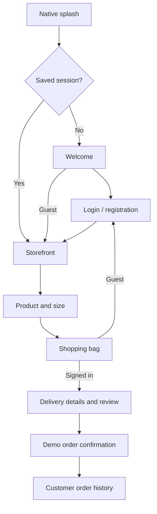

# Meena Bazar — course project report

## Purpose and delivered scope

Meena Bazar is a mobile clothing-shopping prototype for the Introduction to Software Engineering course. The initial brief requires Kotlin/Jetpack Compose, a splash screen, authentication interfaces, registration validation and navigation. This delivery implements those requirements and extends them into a complete offline shopping journey so successful authentication leads to a useful application.

The prototype runs without internet access. Registration creates a local account; checkout saves a demo order. No money is collected, no email is sent and no physical delivery is scheduled.

## Requirements and acceptance criteria

| ID | Requirement | Acceptance criterion |
| --- | --- | --- |
| FR-01 | Application startup | Launch displays a branded native splash, then welcome or the signed-in storefront. No timed second activity is left in the back stack. |
| FR-02 | Authentication navigation | Welcome opens login or registration. Each form links to the other. System Back returns to the originating screen. |
| FR-03 | Registration validation | Blank fields, invalid emails, names outside 2–80 characters, passwords outside 8–128 characters and mismatched confirmation produce inline errors. |
| FR-04 | Local accounts | Valid registration starts a session. Duplicate emails are rejected regardless of case or surrounding spaces. |
| FR-05 | Login/logout | A registered email and matching password log in; incorrect credentials produce an error. Logout preserves that customer's bag and orders. |
| FR-06 | Guest browsing | Guests can browse, search, filter, inspect products and build a bag without an account. |
| FR-07 | Product selection | Adding a product requires a valid size. Different sizes have independent bag lines. |
| FR-08 | Bag management | Users can increase/decrease quantities, remove items and inspect subtotal, delivery and total. Each variant is limited to 10. |
| FR-09 | Checkout | Guests authenticate first and retain their bag. Invalid delivery details block submission. The user explicitly places a demo order after reviewing totals. |
| FR-10 | Orders | A successful order creates an immutable price snapshot, clears the customer's bag and appears in that customer's history. |
| FR-11 | Persistence/isolation | Sessions, bags and orders survive restart; one customer's bag and orders do not appear in another customer's account. |
| NFR-01 | Responsiveness | Password hashing and persistence run off the main thread; progress is visible and duplicate submissions are blocked. |
| NFR-02 | Local credential handling | Passwords are salted and hashed; plaintext passwords are not persisted or saved in rotation bundles. |
| NFR-03 | Usability | Forms scroll, support relevant keyboard types and password visibility, and use accessible Material labels and controls. |
| NFR-04 | Maintainability | UI, state coordination, business rules, storage and theme tokens have separate responsibilities. |

## Use cases

**Register:** Welcome → Create account → enter details → validate → reject duplicate email or save hashed credentials → open storefront. If registration began from a guest bag, return to the bag with its items.

**Browse:** Explore as guest or log in → search/filter collection → open product → choose size → add to bag.

**Place demo order:** Bag → authenticate if needed → delivery form → review totals and demo notice → Place demo order → confirmation → order history.

**Resume:** Reopen app → restore local session → storefront → open saved bag or order history. Logout → another account sees only its own records.

## Design

The UI uses Jetpack Compose and Material 3. A ViewModel exposes `StateFlow` and coordinates navigation and repository actions. Business rules are pure Kotlin and are testable on the JVM. An injected persistence interface separates the repository from Android-specific JSON and private preferences.

A snapshot contains local accounts, the current session email, bags keyed by customer/guest, and order records. Each account stores a name, normalized email, salt and password hash. Orders store item names, sizes, quantities, unit prices, delivery fees, address, timestamp and reference. Existing orders retain their original prices even if the sample catalog later changes.

All amounts are integer BDT values. Delivery costs 80 BDT below 3,000 BDT and is free from that threshold. The sample catalog has eight products across Women, Men, Kids and Accessories. Artwork is drawn directly in Compose and works offline.

## Test strategy

- JVM: invalid/boundary inputs, email normalization, password hashing, duplicate-account rejection, wrong credentials, product variants, quantity limits, guest-bag transfer, customer isolation, delivery costs, order creation and failed writes.
- Instrumentation: real Compose form errors, search/empty-state recovery, Back navigation, size validation, guest registration during checkout, successful demo checkout, order history, rotation and Android JSON persistence.
- Static checks: Android lint and IDE diagnostics.
- Packaging: debug APK and instrumentation APK compiled with the existing Gradle wrapper.

Run the exact commands in the [README](../README.md). Device tests require a fully booted API 28+ emulator or device. Screenshots captured by the device tests are exported through Gradle's additional test output directory. The [verification record](TEST_RESULTS.md) contains the passing results and links to the exported screenshots in `docs/screenshots/`.

## Limitations and next development stage

This is a complete offline course prototype. Local accounts are not internet identities, and all order statuses mean "demo order saved." A production version must replace local authentication and checkout with a server that enforces authorization, stock, pricing and payment/order transactions. Other future work includes verified email, password recovery, social sign-in, delivery tracking, real product imagery, localization and a privacy/data-retention policy.
