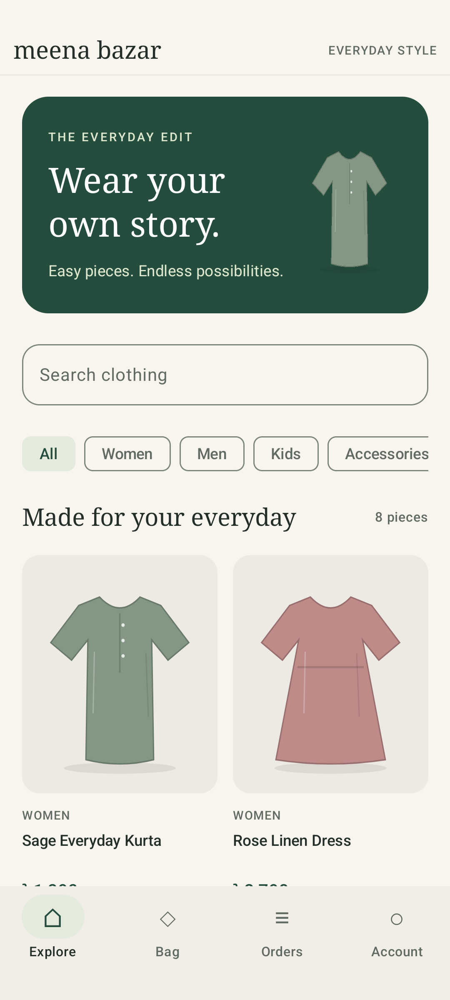

# Verification results

Verified on 19 November 2026 using the Android Studio bundled JDK, Gradle 8.11.1 and a temporary Android 16 / API 36 x86_64 emulator (1080 × 2400).

```powershell
./gradlew.bat --max-workers=2 assembleDebug testDebugUnitTest lintDebug connectedDebugAndroidTest
```

**Final result: BUILD SUCCESSFUL.**

| Check | Result |
| --- | --- |
| Debug APK | Built successfully; approximately 36.1 MiB |
| JVM tests | 25 passed, 0 failed, 0 skipped |
| Android device tests | 5 passed, 0 failed, 0 skipped |
| Android lint | 0 errors, 41 warnings |
| IDE diagnostics | No errors found |

The JVM suites include 6 authentication-validation tests, 14 repository tests, 4 catalog/pricing/delivery tests and the original sample test. Device tests cover application context, registration/login errors, guest search and Back navigation, the complete guest-to-registration-to-checkout journey with order-history rotation, and a JSON account/cart/order round trip without plaintext passwords.

The final lint warnings are dependency/target-version recommendations (31), retained unused original resources (5), existing bitmap resource-folder placement (4), and a KTX-style suggestion (1). Existing SDK levels and dependency versions were preserved; there are no lint errors.

The generated APK is `app/build/outputs/apk/debug/app-debug.apk`. Detailed generated reports are available locally at:

- `app/build/reports/tests/testDebugUnitTest/index.html`
- `app/build/reports/androidTests/connected/debug/index.html`
- `app/build/reports/lint-results-debug.html`

The UI tests reset demo preferences. Use a test emulator/device; do not run them against a demo installation whose local accounts or orders you want to keep.

## Captured screens

These screenshots were captured from the passing device suite and use invented customer details.

| Screen | Screenshot |
| --- | --- |
| Welcome | [welcome.png](screenshots/welcome.png) |
| Registration | [registration.png](screenshots/registration.png) |
| Storefront | [storefront.png](screenshots/storefront.png) |
| Product details | [product.png](screenshots/product.png) |
| Shopping bag | [bag.png](screenshots/bag.png) |
| Checkout | [checkout.png](screenshots/checkout.png) |
| Order confirmation | [order-confirmation.png](screenshots/order-confirmation.png) |


